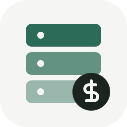
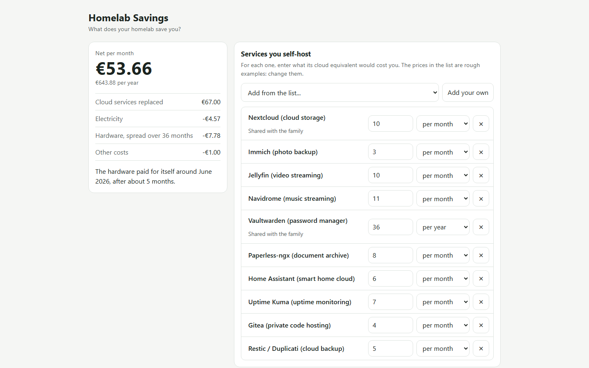
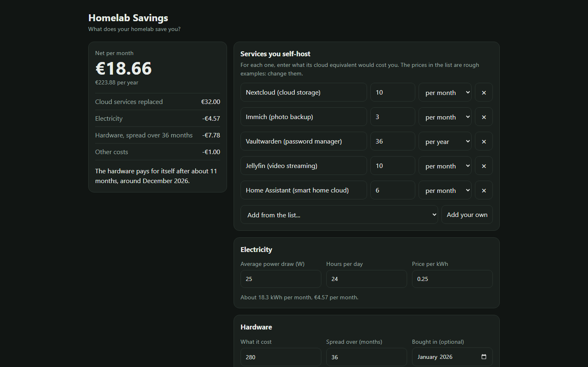

<div align="center">



# Homelab Savings

**What does your homelab save you?**

A tiny calculator: the cloud services you stopped paying for, minus what the homelab costs to run.<br />
One small container, no accounts, no cloud, no tracking.

[](https://github.com/tombino104/homelab-savings/releases)
[](LICENSE)
[](https://github.com/tombino104/homelab-savings/actions/workflows/ci.yml)

</div>

| | |
| --- | --- |
|  |  |

*Made-up example numbers.*

## What it does

- You list the services you self-host and what their cloud equivalent would cost (monthly or yearly), and from which month (a new one starts in the month you add it) and, if you stopped, until which month. A small catalog of common services comes with rough example prices: they are only a starting point, edit them.
- You enter the electricity (watts, hours per day, price per kWh), what the hardware cost and over how many months to spread it, and any other cost (domain, VPN, a faster internet plan...).
- You get the net result per month and per year, the breakdown, the month the hardware pays for itself, how much you have saved so far (hardware included), a chart of it over time and what it will be after 1, 3 and 5 years.
- You can download your numbers as a JSON backup and restore them later.

It is a calculator, not a score: no goals, no colours for good or bad, no notifications.

## Run

You need Docker.

```bash
docker compose up -d
```

Open `http://127.0.0.1:47214`. The numbers are saved in `./data/state.json`.

The image (`ghcr.io/tombino104/homelab-savings`, amd64 and arm64) is a single static binary on an empty base image: about 7 MB, a few MB of RAM when idle. The server listens on `127.0.0.1` only in the sample compose file; put it behind a private network such as Tailscale or a reverse proxy to reach it from other devices.

There is no login. Anyone who can reach the page can read and change the numbers.

### umbrelOS

The app is in the community store [tombino104-store](https://github.com/tombino104/tombino104-store): in the App Store open the menu at the top right, choose **Community App Stores**, add the repository address, then install **Homelab Savings**. umbrelOS keeps its own login in front of it.

## How it is calculated

```
gross savings     = sum of the services (yearly prices divided by 12)
electricity       = watts / 1000 x hours per day x 30.4375 x price per kWh
hardware          = cost / months it is spread over
other costs       = sum of the other costs (yearly prices divided by 12)

net per month     = gross savings - electricity - hardware - other costs
net per year      = net per month x 12

break-even        = hardware cost / (gross savings - electricity - other costs), rounded up to whole months
saved so far      = for each service, its monthly price x the months it was in use
                    - for each other cost, its monthly price x the months it was paid
                    - electricity x months since the start - hardware cost
```

The break-even date is the month you started plus those months; once a start month is set, it is the first month the total saved so far reaches zero, following when each service was added. The totals count whole months and use today's prices for the whole time. If the running costs are at least as high as the savings, there is no break-even. Amounts are never converted between currencies.

## Develop

Go (standard library only) for the server, plain JavaScript modules for the page: no build step, no dependencies.

```bash
go test ./...
npm test
go run .
```

`npm test` only uses the test runner built into Node 24. The calculation is a pure function in [web/js/calc.js](web/js/calc.js). Translations are in `web/locales/`; a test checks that every language has the same keys.

Settings: `PORT` (default `3000`) and `DATA_DIR` (default `./data`).

The page also works as a plain static site (the numbers are then kept in the browser's local storage), which is handy for trying it out: serve the `web/` folder with any static server.

## License

[MIT](LICENSE)
